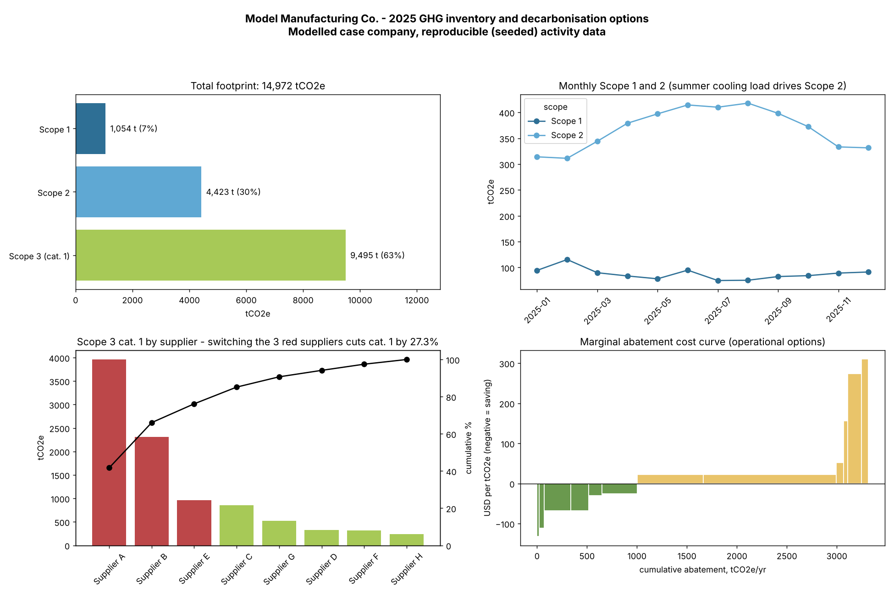

# Scope 1–3 Carbon Dashboard and Decarbonisation Scenarios

[](https://github.com/Rabbani-bot/ghg-carbon-dashboard/actions/workflows/tests.yml)  

> **Case company.** "Model Manufacturing Co." is a modelled manufacturer; all activity data are reproducible (fixed random seed). Emission factors are representative values close to published UK DESNZ/DEFRA 2024 factors and IPCC AR5 GWPs. Replace them with current official factors before using this for real reporting.



## What it does
1. **Inventory (GHG Protocol structure):** activity data × emission factor → tCO2e.
   - Scope 1: natural gas, diesel, refrigerant (R-410A) leakage
   - Scope 2: grid electricity (location-based)
   - Scope 3 category 1: supplier-specific spend intensities (kgCO2e/USD)
2. **Supplier scenario:** swap a supplier's intensity for a lower-carbon alternative; the cost premium changes spend but not the quantity bought.
3. **Marginal abatement cost curve (MACC):** 12 operational options, sorted by annualised net cost per tonne abated.
4. **Outputs:** dashboard PNG, self-contained HTML report, CSV tables, JSON summary.

## Results (computed by the code)
| Metric | Value |
|---|---|
| Total footprint | 14,972 tCO2e |
| Scope 1 / 2 / 3 cat. 1 | 1,054 / 4,423 / 9,495 tCO2e |
| Switching suppliers A, B, E | −27.3% Scope 3 cat. 1 |
| No-regret (negative-cost) abatement | 1,002 tCO2e/yr |
| Total abatement across 12 options | 3,317 tCO2e/yr |

## Quality checks (`tests/`)
7 unit tests: hand-calculated factor check, missing-factor and unit-mismatch errors, scenario never increases emissions, scenario abatement equals the option table, MACC sorted and positive, reproducibility.

## Run
```bash
python3 -m unittest discover -s tests -v
python3 src/build_dashboard.py      # writes outputs/
```
Requires: Python 3.10+, pandas, numpy, matplotlib.

## Files
- `src/generate_data.py` – seeded activity and supplier data
- `src/inventory.py` – Scope 1–3 calculations, scenarios, MACC options
- `src/build_dashboard.py` – figures, HTML report, summary
- `data/emission_factors.csv` – factors with source notes

Author: Mohammad Rabbani – Sustainability Data Analyst & Research Consultant

## Links
- Kaggle notebook: https://www.kaggle.com/rabbani0123 (runnable copy of `notebook.ipynb`)
- Cite: see `CITATION.cff`
- Author: Mohammad Rabbani | Sustainability Data Analyst & Research Assistant

## License
MIT
